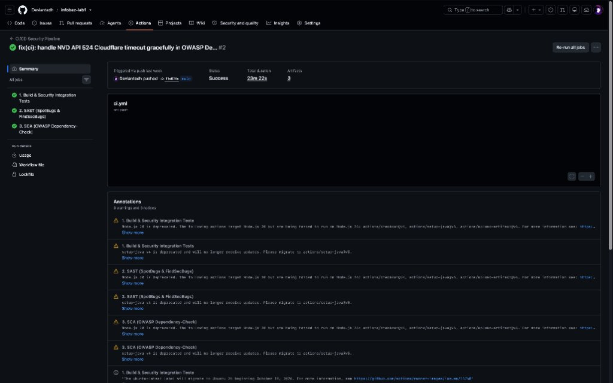

# Secure REST API (ITMO InfoSec Lab 1)

[](https://github.com/Deviantedh/infobez-lab1/actions)
[-brightgreen)](https://github.com/Deviantedh/infobez-lab1/actions/runs/42636644848)

> **Студент:** Носов Георгий Иванович (P3432)  
> **Дисциплина:** Информационная безопасность (ИТМО, 2026)  
> **Последний успешный запуск CI/CD:** [Run #42636644848](https://github.com/Deviantedh/infobez-lab1/actions/runs/42636644848)

---

## 1. Описание проекта и стек

Защищенный REST API сервис на **Java 21** и **Spring Boot 3.3.5** с защитой от основных угроз **OWASP Top 10** и автоматизированным анализом безопасности в **GitHub Actions** (SAST + SCA).

* **Стек:** Spring Boot 3.3.5, Spring Security 6, Spring Data JPA, H2 (In-Memory / Postgres mode).
* **Безопасность:** Stateless JWT (HMAC-SHA256, JJWT 0.12.6), BCrypt (work factor 12).
* **Сканеры в CI/CD:** SpotBugs + FindSecBugs (SAST), OWASP Dependency-Check (SCA).
* **Swagger UI:** `http://localhost:8080/swagger-ui.html` | **OpenAPI:** `/v3/api-docs`.

---

## 2. Спецификация API

| Метод | URL | Доступ | Назначение |
|---|---|---|---|
| `POST` | `/auth/login` | Публичный | Аутентификация пользователя (логин/пароль) и выдача Bearer JWT |
| `POST` | `/auth/register` | Публичный | Регистрация нового пользователя с хэшированием пароля BCrypt |
| `GET` | `/auth/me` | Bearer JWT | Профиль текущего аутентифицированного пользователя |
| `GET` | `/api/data` | Bearer JWT | Защищенный список конфиденциальных данных |
| `POST` | `/api/data` | Bearer JWT | Создание новой записи с контекстной санитизацией HTML |
| `GET` | `/api/data/{id}` | Bearer JWT | Параметризованное получение записи по ID (JPA) |

### Примеры вызовов (cURL):

```bash
# 1. Вход и получение токена
curl -s -X POST http://localhost:8080/auth/login \
  -H "Content-Type: application/json" \
  -d '{"username":"admin","password":"admin123"}'

# 2. Доступ к данным без токена -> 401 Unauthorized
curl -i http://localhost:8080/api/data

# 3. Доступ с валидным JWT
curl -s -X GET http://localhost:8080/api/data \
  -H "Authorization: Bearer <TOKEN>"

# 4. Создание записи с проверкой санитизации XSS
curl -s -X POST http://localhost:8080/api/data \
  -H "Authorization: Bearer <TOKEN>" \
  -H "Content-Type: application/json" \
  -d '{"title":"<script>alert(1)</script> Тест","content":"Текст","classificationLevel":"INTERNAL"}'
# В ответе и БД теги экранируются: &lt;script&gt;alert(1)&lt;/script&gt;
```

---

## 3. Реализованные меры защиты

### 1. Broken Authentication (A07:2021)
* **BCrypt (work factor 12):** пароли не хранятся в открытом виде; соль генерируется индивидуально, исключая атаки по радужным таблицам (Rainbow Tables).
* **Stateless JWT (HMAC-SHA256):** сессии на сервере не сохраняются (`SessionCreationPolicy.STATELESS`). `JwtAuthenticationFilter` перехватывает запросы и валидирует подпись и срок жизни токена (24h).
* **User Enumeration Prevention:** при неверном логине или пароле возвращается одинаковый обезличенный ответ `401 Unauthorized` без подсказок о наличии логина в базе.

### 2. SQL Injection (A03:2021)
* **Spring Data JPA / Hibernate:** конкатенация строк исключена, все запросы выполняются через строго типизированные `Prepared Statements`.
* **Bean Validation:** входные DTO валидируются регулярными выражениями (`@Pattern`, `@NotBlank`, `@Size`).

### 3. Cross-Site Scripting (XSS, A03:2021)
* **Санитизация ввода:** данные перед сохранением экранируются методом `HtmlUtils.htmlEscape()`.
* **Security Headers:** в `SecurityConfig` настроены заголовки `Content-Security-Policy: default-src 'self'`, `X-Frame-Options: SAMEORIGIN`, `X-XSS-Protection: 1; mode=block` и `X-Content-Type-Options: nosniff`.

### 4. Information Disclosure Prevention (A05:2021)
* `GlobalExceptionHandler` логирует stack trace только на сервере, отдавая наружу стандартизированные безопасные JSON-ошибки.

---

## 4. CI/CD Pipeline и Security-сканеры

В репозитории настроен GitHub Actions workflow [`.github/workflows/ci.yml`](.github/workflows/ci.yml) из 3 параллельно-последовательных этапов:
1. **Tests:** компиляция под JDK 21 и прогон 8 интеграционных тестов безопасности (`SecurityIntegrationTest`).
2. **SAST:** статический анализ байткода через SpotBugs 4.8.6 + FindSecBugs 1.13.0 (**0 уязвимостей**).
3. **SCA:** анализ зависимостей сканером OWASP Dependency-Check 10.0.4 (**0 High/Critical CVE**).

### Результат выполнения Pipeline:



* Прямая ссылка на запуск: [GitHub Actions Run #42636644848](https://github.com/Deviantedh/infobez-lab1/actions/runs/42636644848)
* Выгруженные артефакты: `surefire-test-reports`, `spotbugs-sast-report`, `dependency-check-report`.

---

## 5. Быстрый запуск

```bash
# Тесты безопасности:
./mvnw clean test

# Локальный запуск SAST SpotBugs:
./mvnw compile spotbugs:check

# Запуск приложения (порт 8080):
./mvnw spring-boot:run
```

*Тестовые учетные записи создаются автоматически при старте:*
* `admin` / `admin123` (роль `ROLE_ADMIN`)
* `user` / `user123` (роль `ROLE_USER`)
